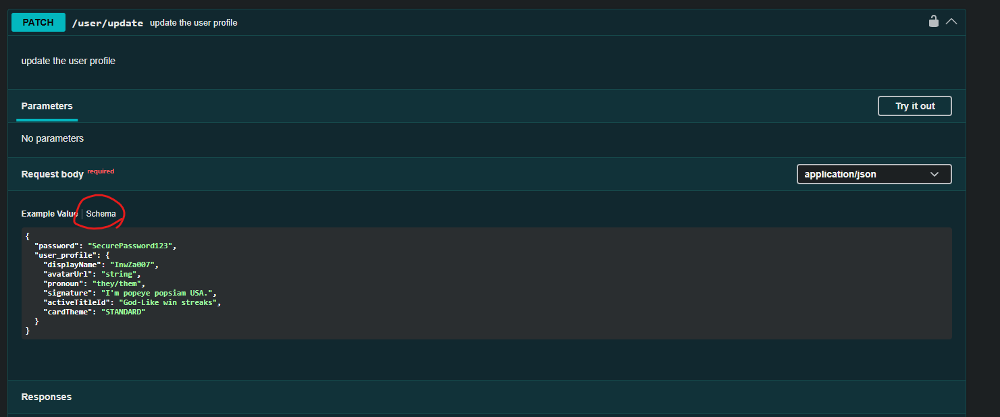
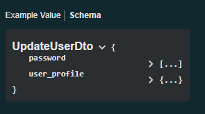

# How to work with API for frontend tutorial

## requirements
- to easily work the nestjs HTTP API endpoints. For this project i recommend you to use the nestjs's swagger Api documentation and the main source of truth

## some basic understandings
- you would normally use the <b>fetch()</b> function in front end to fetch some data to backend
- the normal path for api is "/api/\<endpoints\>" 

## Step by Step
1. please take a look at api documentation to what endpoint use want to use first. https://localhost:4333/nestjs/api-docs
2. if the request needs a body you would see the schema button



3. and you would get the name of the schema



4. in nextjs directory, go into data/src/types/dto.ts and then add new dto that you need. having the name as same as the documentation made it easiler and clearer to understand

```typescript
import type { components } from "./api.js";


export type UpdateUserDto = components['schemas']['UpdateUserDto'];

```

5. now when you need to work with payload from fetch() you can just
you these dto. i hope this will help.